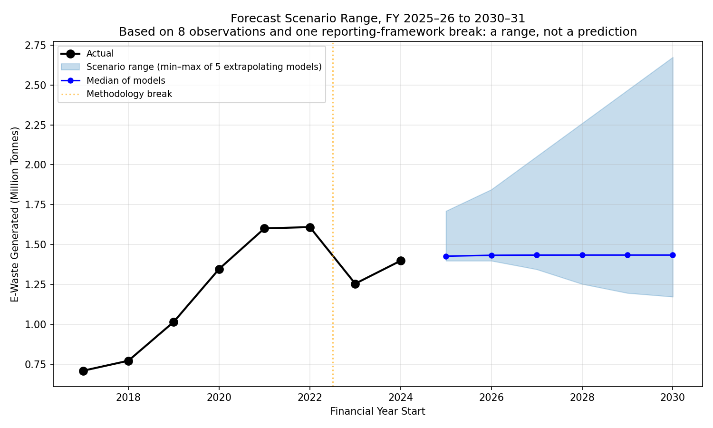
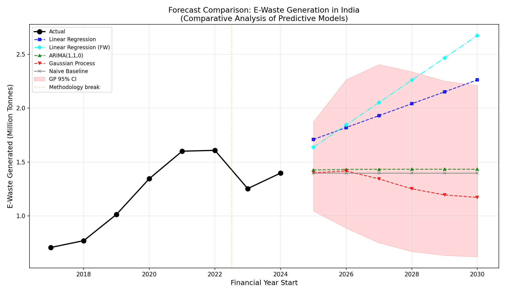
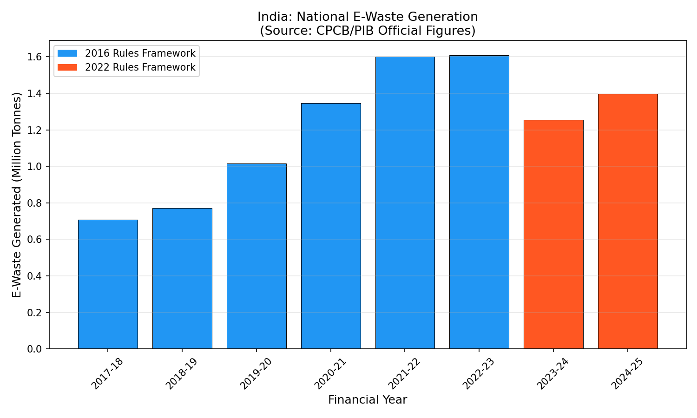
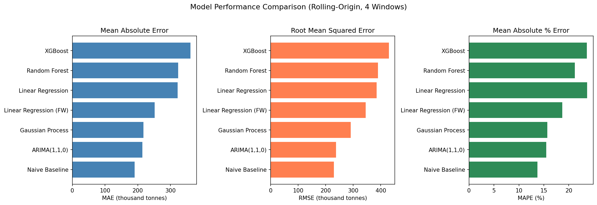
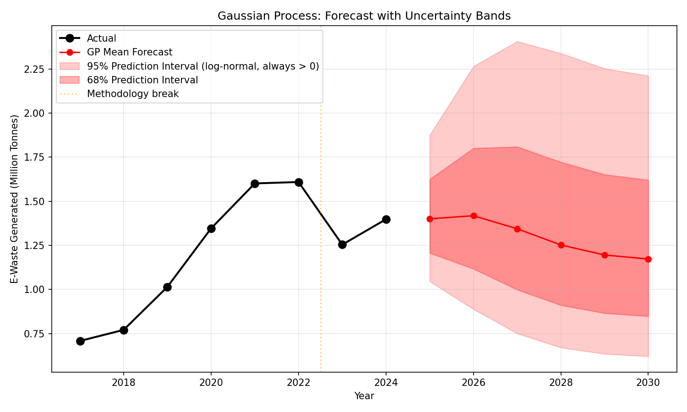

# Comparative Analysis of Predictive Models for E-Waste Generation Forecasting in India

[](https://www.python.org/)
[](#)
[](https://cpcb.nic.in/)
[](outputs/power_bi/POWER_BI_DASHBOARD_GUIDE.md)

**Subject:** Enterprise Information Systems (EIS)  
**Academic Domain:** Environmental Analytics, Time-Series Forecasting & Decision Support Systems  
**Project Repository:** [Comparative-Analysis-EWaste-Forecasting-India](https://github.com/aryannlodha/Comparative-Analysis-EWaste-Forecasting-India)  

---

## Executive Summary

This repository hosts the data science and predictive modeling pipeline for forecasting national electronic waste (e-waste) generation in India through 2030. Grounded in Enterprise Information Systems (EIS) principles, this project audits raw institutional records from the Central Pollution Control Board (CPCB) and Ministry of Environment, Forest and Climate Change (MoEFCC), uncovers critical regulatory methodology breaks across statutory regimes, evaluates seven variants from six model families using chronological rolling-origin backtesting, and delivers decision-support outputs ready for Microsoft Power BI and interactive web inspection.

---

## Visual Highlights

### 1. Headline Forecast: Scenario Range Through FY 2030–31


### 1b. Individual Model Trajectories (diagnostic view)


### 2. Historical Baseline & Regulatory Framework Transition


### 3. Chronological Model Evaluation Metrics (MAE, RMSE, MAPE)


### 4. Bayesian Gaussian Process Predictive Uncertainty Expansion


---

## Key Research Findings & Contributions

1. **Statutory Structural Break Discovery:** The official historical series contains an apparent discontinuity between FY 2022–23 ($1.61\text{ M MT}$ under the 2016 Rules / 21 EEE categories) and FY 2023–24 ($1.25\text{ M MT}$ under the 2022 Rules / 106 categories on registered-producer portal data). The framework change limits comparisons of physical volumes across those years. CPCB continued to use producer sales and equipment lifetimes to estimate generation. [MoEFCC parliamentary reply](https://www.pib.gov.in/PressReleasePage.aspx?PRID=2147876)
2. **Empirical Evaluation Under Data Scarcity ($n=8$):** In chronological backtesting across 4 expanding origins (4 test points per model), the naive baseline had the lowest error. **The ranking below is not statistically reliable**: dropping a single fold moves most models by several rank positions (see `outputs/model_results/fold_sensitivity.csv`; e.g. Gaussian Process ranks anywhere from 1st to 5th, XGBoost 5th to 7th). Treat the top four as indistinguishable.
   - **Naive Baseline:** $\text{MAE} = 190,280\text{ MT}$ ($13.7\%\text{ MAPE}$)
   - **ARIMA(1,1,0):** $\text{MAE} = 214,388\text{ MT}$ ($15.5\%\text{ MAPE}$) — *near-flat forecast (no drift), so it behaves almost like the naive baseline*
   - **Gaussian Process (log-space):** $\text{MAE} = 217,264\text{ MT}$ ($15.7\%\text{ MAPE}$)
   - **Linear Regression (Framework-Adjusted):** $\text{MAE} = 251,994\text{ MT}$ ($18.7\%\text{ MAPE}$) — *this is **not** a demonstrated modelling improvement: the framework flag is constant (all zeros) in the training data of folds 1–3, so the model is identical to standard linear regression there. Its 21.7% MAE gain over standard linear regression comes entirely from the final fold, where the flag is estimated from a single post-break point (`framework_flag_diagnostic.csv`).*
   - **Linear Regression (Standard):** $\text{MAE} = 322,003\text{ MT}$ ($23.7\%\text{ MAPE}$)
   - **Random Forest:** $\text{MAE} = 323,631\text{ MT}$ ($21.2\%\text{ MAPE}$)
   - **XGBoost:** $\text{MAE} = 361,350\text{ MT}$ ($23.6\%\text{ MAPE}$)
3. **Machine Learning Extrapolation Boundary:** Tree ensembles (Random Forest, XGBoost) cannot extrapolate beyond the training range, so they return a constant plateau (~$1.43\text{ M MT}$) after 2025. This is expected behaviour, not evidence about future trend, and these models are therefore excluded from the scenario range. The framework-adjusted linear model's 2.67 million tonnes for FY 2030–31 is the *upper end* of the range and depends on a flag coefficient estimated from only two post-break observations.
4. **Forecast Uncertainty:** The Gaussian process is fitted to standardized log(tonnes), so its median forecast and every interval bound are strictly positive. Its 95% interval for FY 2030–31 is 621,766 – 2,211,193 tonnes. The equivalent standard deviation (half-width of the 95% interval / 1.96) grows from about 211,000 tonnes in FY 2025–26 to about 405,000 in FY 2030–31 (+92%). These model-implied bands have untested coverage. *(An earlier version of this project fitted the GP on raw tonnes, which produced a negative lower bound of −1.22 M tonnes and a falling mean of 229,283 tonnes by FY 2030–31; that was an artefact of the unscaled kernel.)*

---

## Forecasts Through FY 2030–31

**Read this as a range, not a prediction.** With 8 observations and a reporting-framework break inside the series, the models cannot be ranked and their long-horizon forecasts disagree widely. The scenario range below is the minimum, median and maximum across the five models that can extrapolate (Naive, Linear Regression, Linear Regression (FW), ARIMA(1,1,0), Gaussian Process). Source: `outputs/model_results/scenario_band.csv`.

| Financial Year | Low | Median of models | High | Low set by | High set by |
| :---: | :---: | :---: | :---: | :---: | :---: |
| **2025–26** | 1,397,956 MT | 1,426,696 MT | 1,710,046 MT | Naive | Linear Reg (Std) |
| **2026–27** | 1,397,956 MT | 1,432,446 MT | 1,844,759 MT | Naive | Linear Reg (FW) |
| **2027–28** | 1,344,182 MT | 1,433,596 MT | 2,052,214 MT | Gaussian Process | Linear Reg (FW) |
| **2028–29** | 1,252,429 MT | 1,433,826 MT | 2,259,669 MT | Gaussian Process | Linear Reg (FW) |
| **2029–30** | 1,195,686 MT | 1,433,872 MT | 2,467,124 MT | Gaussian Process | Linear Reg (FW) |
| **2030–31** | 1,172,537 MT | 1,433,882 MT | 2,674,580 MT | Gaussian Process | Linear Reg (FW) |

<details>
<summary>Individual model point forecasts (diagnostic detail)</summary>

| Financial Year | Naive Baseline | Linear Reg (Std) | Linear Reg (FW) | ARIMA(1,1,0) | Random Forest | XGBoost | Gaussian Process (median) | GP 95% prediction interval |
| :---: | :---: | :---: | :---: | :---: | :---: | :---: | :---: | :---: |
| **2025–26** | 1,397,956 MT | 1,710,046 MT | 1,637,304 MT | 1,426,696 MT | 1,424,710 MT | 1,438,663 MT | 1,400,516 MT | $[1,046,199 \text{ to } 1,874,829]$ |
| **2026–27** | 1,397,956 MT | 1,820,511 MT | 1,844,759 MT | 1,432,446 MT | 1,424,710 MT | 1,438,663 MT | 1,418,246 MT | $[888,305 \text{ to } 2,264,339]$ |
| **2027–28** | 1,397,956 MT | 1,930,976 MT | 2,052,214 MT | 1,433,596 MT | 1,424,710 MT | 1,438,663 MT | 1,344,182 MT | $[750,908 \text{ to } 2,406,185]$ |
| **2028–29** | 1,397,956 MT | 2,041,441 MT | 2,259,669 MT | 1,433,826 MT | 1,424,710 MT | 1,438,663 MT | 1,252,429 MT | $[670,747 \text{ to } 2,338,553]$ |
| **2029–30** | 1,397,956 MT | 2,151,906 MT | 2,467,124 MT | 1,433,872 MT | 1,424,710 MT | 1,438,663 MT | 1,195,686 MT | $[634,704 \text{ to } 2,252,490]$ |
| **2030–31** | 1,397,956 MT | 2,262,371 MT | 2,674,580 MT | 1,433,882 MT | 1,424,710 MT | 1,438,663 MT | 1,172,537 MT | $[621,766 \text{ to } 2,211,193]$ |

</details>

### Additional diagnostics written by `03_train_evaluate_forecast.py` (`outputs/model_results/`)
- `fold_sensitivity.csv` — per-fold errors, MAE with each fold dropped, and best/worst rank per model.
- `framework_flag_diagnostic.csv` — whether the framework flag is identifiable in each backtest fold.
- `arima_order_comparison.csv` — ARIMA orders (0/1,1,0/1) with and without drift on the same folds. ARIMA(1,1,1) scores lower MAE (172,843; 138,185 with drift) but its fits emit convergence warnings and it was picked from 8 candidates using only 4 test points, so it is reported as a sensitivity check and is **not** adopted as the headline model.
- `arima_diagnostics.csv` — every ARIMA fallback-to-naive or convergence event (ARIMA failures are no longer silent).
- `scenario_band.csv` — the range table above.

---

## Repository Structure

```text
Comparative-Analysis-EWaste-Forecasting-India/
├── original_data/                   # Preserved original input workbooks (READ-ONLY)
│   ├── E-WASTE VALUE.xlsx
│   ├── EWaste_Forecasting_Master_Data.xlsx
│   └── RS_Session_266_AU_2384_A.csv
├── data/
│   └── processed/                   # Cleaned, standardized, verified CSVs
│       ├── national_ewaste_full.csv
│       ├── national_ewaste_2016rules.csv
│       ├── national_ewaste_2022rules.csv
│       ├── external_benchmarks.csv
│       └── data_dictionary.csv
├── src/                             # Python source code
│   ├── 01_inspect_and_audit.py      # Data inspection & audit script
│   ├── 02_prepare_data.py           # Data preparation & split logic
│   ├── 03_train_evaluate_forecast.py# Modeling, evaluation, robustness, forecasting
│   ├── generate_interactive_dashboard.py # Generates standalone HTML5 dashboard
│   ├── inspect_workbooks.py         # Workbook inspection utility
│   ├── audit_data.py                # Audit execution runner
│   ├── prepare_data.py              # Data prep runner
│   ├── train_models.py              # Training runner
│   ├── evaluate_models.py           # Evaluation runner
│   ├── robustness_tests.py          # Robustness runner
│   ├── generate_forecasts.py        # Forecast generator runner
│   ├── export_results.py            # Artifact manifest checker
│   └── run_pipeline.py              # Full end-to-end pipeline execution
├── outputs/
│   ├── figures/                     # High-resolution generated charts
│   │   ├── fig1_historical_trend.png
│   │   ├── fig2_forecast_comparison.png
│   │   ├── fig3_model_performance.png
│   │   ├── fig4_noise_robustness.png
│   │   ├── fig5_gp_uncertainty.png
│   │   └── fig6_training_size.png
│   ├── power_bi/                    # Clean CSVs formatted for Power BI Desktop
│   │   ├── historical_data.csv
│   │   ├── forecast_results.csv
│   │   ├── model_metrics.csv
│   │   ├── model_predictions.csv
│   │   ├── model_robustness_results.csv
│   │   ├── data_quality_report.csv
│   │   ├── source_register.csv
│   │   └── POWER_BI_DASHBOARD_GUIDE.md # Power BI setup & DAX measures guide
│   ├── dashboard/                   # Interactive decision-support web viewer
│   │   └── index.html
│   └── reports/                     # Formal academic research reports
│       ├── DATA_AUDIT_REPORT.md     # Phase 1 formal data audit
│       ├── cross_source_comparison.csv
│       └── RESEARCH_REPORT.md       # Full academic paper
├── run_dashboard.py                 # Double-click/run to open interactive dashboard
├── README.md                        # Project documentation (this file)
├── requirements.txt                 # Python dependencies
├── data_dictionary.md               # Column-level data dictionary
├── methodology.md                   # Modeling methodology & mathematical formulation
└── source_register.csv              # Source provenance register
```

---

## Installation & How to Run

For changes to data or forecasting code, regenerate the dashboard and model exports
with `python src/run_pipeline.py`, then run `python -m unittest discover -s tests`.
Include the affected outputs in the same pull request. GitHub Actions checks the
published results and reruns the pipeline on pull requests and pushes to `main`.

### 1. Prerequisites
- Python 3.10+ (Tested on Python 3.11)
- Install required packages:
  ```bash
  pip install -r requirements.txt        # or requirements-lock.txt for the exact versions the results were verified with
  ```

### 2. Run the Complete End-to-End Pipeline
To re-run the entire pipeline from raw data audit to final dashboard generation:
```bash
python src/run_pipeline.py
```

### 3. Launch the Interactive Decision-Support Dashboard
Open the standalone multi-page dashboard in your default browser:
```bash
python run_dashboard.py
```
*(Or navigate to `outputs/dashboard/index.html` and double-click to open in any web browser).*

### 4. Import Data into Microsoft Power BI
Refer to the step-by-step instructions, Star Schema diagram, and DAX measures provided in [`outputs/power_bi/POWER_BI_DASHBOARD_GUIDE.md`](outputs/power_bi/POWER_BI_DASHBOARD_GUIDE.md).

---

## Academic & Regulatory References

1. **Wasim Ayub Bagwan (2024).** "Electronic waste (E-waste) generation and management scenario of India, and ARIMA forecasting of E-waste processing capacity of Maharashtra state till 2030." *Waste Management Bulletin*, 1, 41–51. [DOI: 10.1016/j.wmb.2023.08.002](https://doi.org/10.1016/j.wmb.2023.08.002).
2. **Baldé, C. P. et al. (2024).** *Global E-waste Monitor 2024.* ITU & UNITAR, Geneva/Bonn. ISBN: 978-92-61-38781-5. [https://ewastemonitor.info/](https://ewastemonitor.info/).
3. **Duman, G. M., Kongar, E., & Gupta, S. M. (2019).** "Estimation of electronic waste using optimized multivariate grey models." *Waste Management*, 95, 241–249. [DOI: 10.1016/j.wasman.2019.06.023](https://doi.org/10.1016/j.wasman.2019.06.023).
4. **CPCB / MoEFCC (2022).** *E-Waste (Management) Rules, 2022.* Ministry of Environment, Forest and Climate Change, Government of India. Notification S.O. 5075(E).
5. **Press Information Bureau (PIB) (2023, 2025).** Official releases on E-Waste Generation & Processing Infrastructure. PRID: 1943201 (27 Jul 2023) & PRID: 2147876 (24 Jul 2025).
