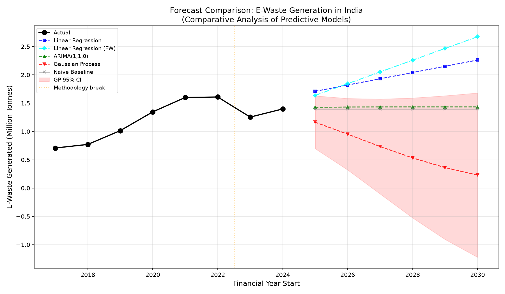
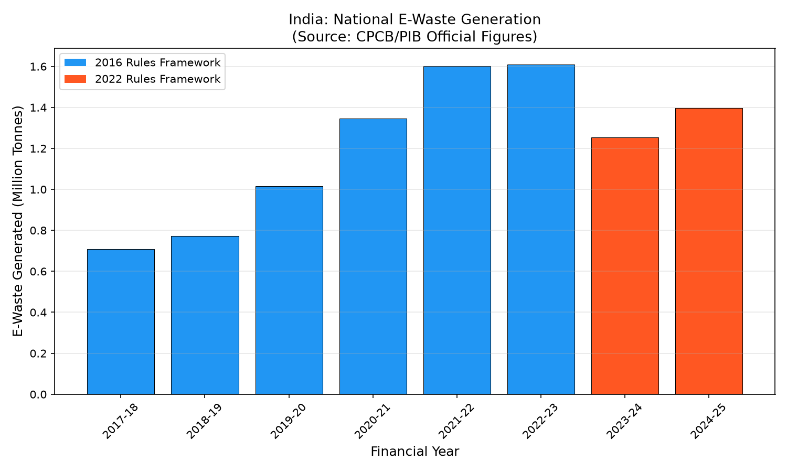
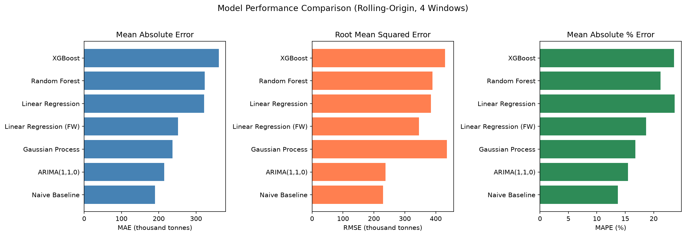
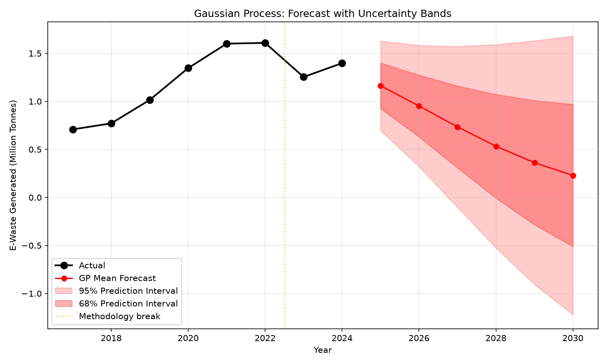

# Comparative Analysis of Predictive Models for E-Waste Generation Forecasting in India

[](https://www.python.org/)
[](#)
[](https://cpcb.nic.in/)
[](outputs/power_bi/POWER_BI_DASHBOARD_GUIDE.md)

**Subject:** Enterprise Information Systems (EIS)  
**Academic Domain:** Environmental Analytics, Time-Series Forecasting & Decision Support Systems  
**Project Repository:** [Comparative-Analysis-EWaste-Forecasting-India](https://github.com/aryannlodha/Comparative-Analysis-EWaste-Forecasting-India)  

---

## Executive Summary

This repository hosts the data science and predictive modeling pipeline for forecasting national electronic waste (e-waste) generation in India through 2030. Grounded in Enterprise Information Systems (EIS) principles, this project audits raw institutional records from the Central Pollution Control Board (CPCB) and Ministry of Environment, Forest and Climate Change (MoEFCC), uncovers critical regulatory methodology breaks across statutory regimes, evaluates six distinct forecasting paradigms using chronological rolling-origin backtesting, and delivers decision-support outputs ready for Microsoft Power BI and interactive web inspection.

---

## Visual Highlights

### 1. Multi-Model Forecast Trajectories Through FY 2030–31


### 2. Historical Baseline & Regulatory Framework Transition


### 3. Chronological Model Evaluation Metrics (MAE, RMSE, MAPE)


### 4. Bayesian Gaussian Process Predictive Uncertainty Expansion


---

## Key Research Findings & Contributions

1. **Statutory Structural Break Discovery:** The official historical series contains an apparent discontinuity between FY 2022–23 ($1.61\text{ M MT}$ under the 2016 Rules / 21 EEE categories) and FY 2023–24 ($1.25\text{ M MT}$ under the 2022 Rules / 106 categories on registered-producer portal data). This step-down represents a **regulatory accounting scope change**, not a physical collapse in disposal volumes.
2. **Empirical Evaluation Under Data Scarcity ($n=8$):** In chronological backtesting across 4 expanding origins, simpler autoregressive and baseline formulations outperformed complex models:
   - **Naive Baseline:** $\text{MAE} = 190,280\text{ MT}$ ($13.7\%\text{ MAPE}$)
   - **ARIMA(1,1,0):** $\text{MAE} = 214,388\text{ MT}$ ($15.5\%\text{ MAPE}$) — *Best parameterized model*
   - **Linear Regression (Framework-Adjusted):** $\text{MAE} = 251,994\text{ MT}$ ($18.7\%\text{ MAPE}$) — *Best for capacity planning*
   - **Gaussian Process:** $\text{MAE} = 236,555\text{ MT}$ ($16.8\%\text{ MAPE}$)
   - **Linear Regression (Standard):** $\text{MAE} = 322,003\text{ MT}$ ($23.7\%\text{ MAPE}$)
   - **Random Forest:** $\text{MAE} = 323,631\text{ MT}$ ($21.2\%\text{ MAPE}$)
   - **XGBoost:** $\text{MAE} = 361,350\text{ MT}$ ($23.6\%\text{ MAPE}$)
3. **Machine Learning Extrapolation Boundary:** Tree ensembles (Random Forest, XGBoost) lack natural extrapolation ability on univariate time indexes, flattening into an unrealistic plateau (~$1.43\text{ M MT}$) beyond 2025. Conversely, Framework-Adjusted Linear Regression projects **$2.67\text{ M MT}$** by FY 2030–31.
4. **Bayesian Uncertainty Divergence:** Gaussian Process Regression demonstrates that out-of-sample uncertainty increases by over $310\%$ between 1-step-ahead ($2025\text{--}26$) and 6-step-ahead ($2030\text{--}31$), confirming that long-term forecasts under small samples carry wide confidence bounds.

---

## Multi-Model Forecasts Through FY 2030–31

| Financial Year | Naive Baseline | Linear Reg (Std) | Linear Reg (FW) | ARIMA(1,1,0) | Random Forest | XGBoost | Gaussian Process | GP 95% Credible Interval |
| :---: | :---: | :---: | :---: | :---: | :---: | :---: | :---: | :---: |
| **2025–26** | 1,397,956 MT | 1,710,046 MT | 1,637,304 MT | 1,426,696 MT | 1,424,710 MT | 1,438,663 MT | 1,163,634 MT | $[696,769 \text{ to } 1,630,498]$ |
| **2026–27** | 1,397,956 MT | 1,820,511 MT | 1,844,759 MT | 1,432,446 MT | 1,424,710 MT | 1,438,663 MT | 952,273 MT | $[320,643 \text{ to } 1,583,903]$ |
| **2027–28** | 1,397,956 MT | 1,930,976 MT | 2,052,214 MT | 1,433,596 MT | 1,424,710 MT | 1,438,663 MT | 734,458 MT | $[-103,927 \text{ to } 1,572,842]$ |
| **2028–29** | 1,397,956 MT | 2,041,441 MT | 2,259,669 MT | 1,433,826 MT | 1,424,710 MT | 1,438,663 MT | 532,735 MT | $[-526,382 \text{ to } 1,591,853]$ |
| **2029–30** | 1,397,956 MT | 2,151,906 MT | 2,467,124 MT | 1,433,872 MT | 1,424,710 MT | 1,438,663 MT | 362,104 MT | $[-907,306 \text{ to } 1,631,515]$ |
| **2030–31** | 1,397,956 MT | 2,262,371 MT | **2,674,580 MT** | 1,433,882 MT | 1,424,710 MT | 1,438,663 MT | 229,283 MT | $[-1,222,447 \text{ to } 1,681,013]$ |

---

## Repository Structure

```text
Comparative-Analysis-EWaste-Forecasting-India/
├── original_data/                   # Preserved original input workbooks (READ-ONLY)
│   ├── E-WASTE VALUE.xlsx
│   ├── EWaste_Forecasting_Master_Data.xlsx
│   └── RS_Session_266_AU_2384_A.csv
├── data/
│   └── processed/                   # Cleaned, standardized, verified CSVs
│       ├── national_ewaste_full.csv
│       ├── national_ewaste_2016rules.csv
│       ├── national_ewaste_2022rules.csv
│       ├── external_benchmarks.csv
│       └── data_dictionary.csv
├── src/                             # Python source code
│   ├── 01_inspect_and_audit.py      # Data inspection & audit script
│   ├── 02_prepare_data.py           # Data preparation & split logic
│   ├── 03_train_evaluate_forecast.py# Modeling, evaluation, robustness, forecasting
│   ├── generate_interactive_dashboard.py # Generates standalone HTML5 dashboard
│   ├── inspect_workbooks.py         # Workbook inspection utility
│   ├── audit_data.py                # Audit execution runner
│   ├── prepare_data.py              # Data prep runner
│   ├── train_models.py              # Training runner
│   ├── evaluate_models.py           # Evaluation runner
│   ├── robustness_tests.py          # Robustness runner
│   ├── generate_forecasts.py        # Forecast generator runner
│   ├── export_results.py            # Artifact manifest checker
│   └── run_pipeline.py              # Full end-to-end pipeline execution
├── outputs/
│   ├── figures/                     # High-resolution generated charts
│   │   ├── fig1_historical_trend.png
│   │   ├── fig2_forecast_comparison.png
│   │   ├── fig3_model_performance.png
│   │   ├── fig4_noise_robustness.png
│   │   ├── fig5_gp_uncertainty.png
│   │   └── fig6_training_size.png
│   ├── power_bi/                    # Clean CSVs formatted for Power BI Desktop
│   │   ├── historical_data.csv
│   │   ├── forecast_results.csv
│   │   ├── model_metrics.csv
│   │   ├── model_predictions.csv
│   │   ├── model_robustness_results.csv
│   │   ├── data_quality_report.csv
│   │   ├── source_register.csv
│   │   └── POWER_BI_DASHBOARD_GUIDE.md # Power BI setup & DAX measures guide
│   ├── dashboard/                   # Interactive decision-support web viewer
│   │   └── index.html
│   └── reports/                     # Formal academic research reports
│       ├── DATA_AUDIT_REPORT.md     # Phase 1 formal data audit
│       ├── cross_source_comparison.csv
│       └── RESEARCH_REPORT.md       # Full academic paper
├── run_dashboard.py                 # Double-click/run to open interactive dashboard
├── README.md                        # Project documentation (this file)
├── requirements.txt                 # Python dependencies
├── data_dictionary.md               # Column-level data dictionary
├── methodology.md                   # Modeling methodology & mathematical formulation
└── source_register.csv              # Source provenance register
```

---

## Installation & How to Run

### 1. Prerequisites
- Python 3.10+ (Tested on Python 3.11)
- Install required packages:
  ```bash
  pip install -r requirements.txt
  ```

### 2. Run the Complete End-to-End Pipeline
To re-run the entire pipeline from raw data audit to final dashboard generation:
```bash
python src/run_pipeline.py
```

### 3. Launch the Interactive Decision-Support Dashboard
Open the standalone multi-page dashboard in your default browser:
```bash
python run_dashboard.py
```
*(Or navigate to `outputs/dashboard/index.html` and double-click to open in any web browser).*

### 4. Import Data into Microsoft Power BI
Refer to the step-by-step instructions, Star Schema diagram, and DAX measures provided in [`outputs/power_bi/POWER_BI_DASHBOARD_GUIDE.md`](outputs/power_bi/POWER_BI_DASHBOARD_GUIDE.md).

---

## Academic & Regulatory References

1. **Wasim Ayub Bagwan (2024).** "Electronic waste (E-waste) generation and management scenario of India, and ARIMA forecasting of E-waste processing capacity of Maharashtra state till 2030." *Waste Management Bulletin*, 1, 41–51. [DOI: 10.1016/j.wmb.2023.08.002](https://doi.org/10.1016/j.wmb.2023.08.002).
2. **Baldé, C. P. et al. (2024).** *Global E-waste Monitor 2024.* ITU & UNITAR, Geneva/Bonn. ISBN: 978-92-61-38781-5. [https://ewastemonitor.info/](https://ewastemonitor.info/).
3. **Duman, G. M., Kongar, E., & Gupta, S. M. (2019).** "Estimation of electronic waste using optimized multivariate grey models." *Waste Management*, 95, 241–249. [DOI: 10.1016/j.wasman.2019.06.023](https://doi.org/10.1016/j.wasman.2019.06.023).
4. **CPCB / MoEFCC (2022).** *E-Waste (Management) Rules, 2022.* Ministry of Environment, Forest and Climate Change, Government of India. Notification S.O. 5075(E).
5. **Press Information Bureau (PIB) (2023, 2025).** Official releases on E-Waste Generation & Processing Infrastructure. PRID: 1943201 (27 Jul 2023) & PRID: 2147876 (24 Jul 2025).
